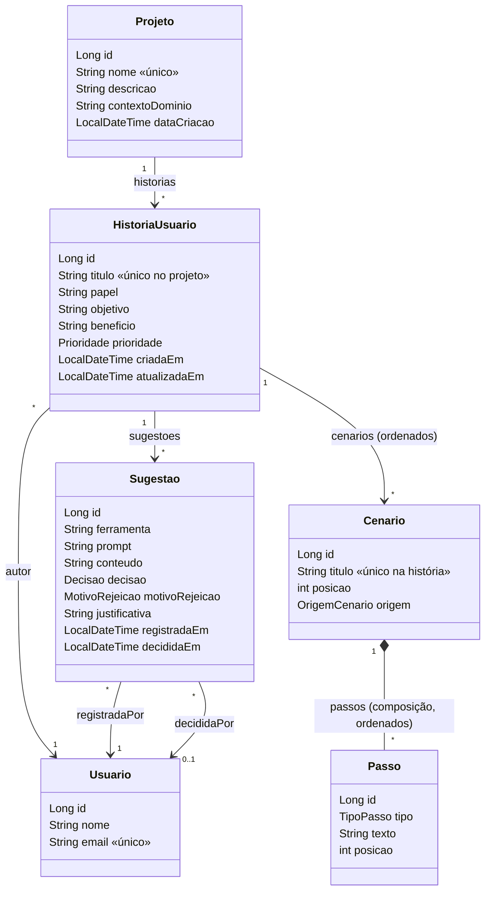

# Diagrama de classes

Enums: `Prioridade` (ALTA, MEDIA, BAIXA), `OrigemCenario` (HUMANO, SUGESTAO_IA),
`TipoPasso` (DADO, QUANDO, ENTAO, E, MAS), `Decisao` (PENDENTE, ACEITA, REJEITADA),
`MotivoRejeicao` (INCORRETA, GENERICA, DUPLICADA, FORA_DO_ESCOPO, OUTRO).
